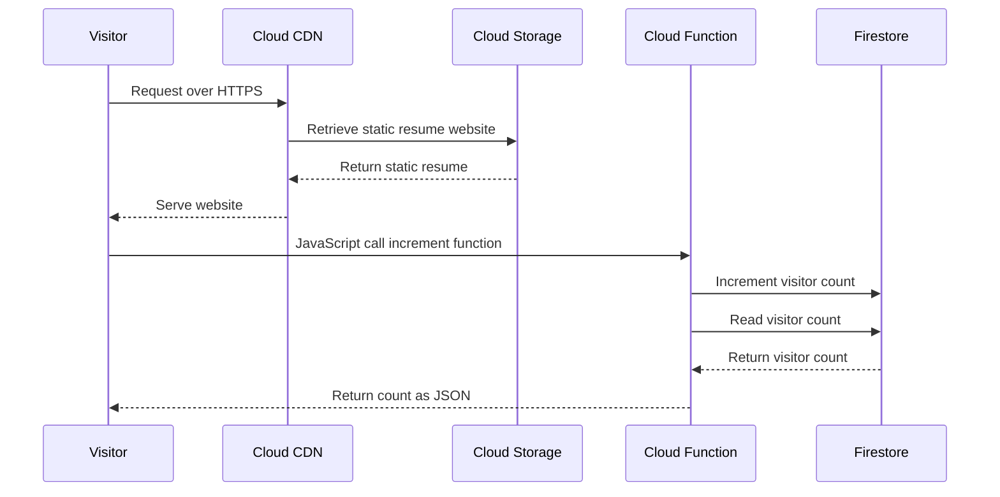
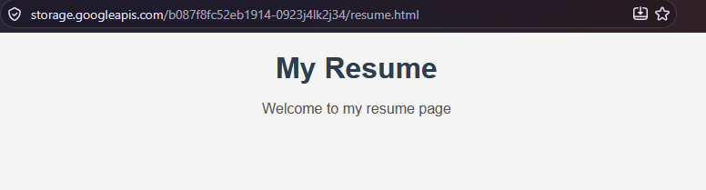
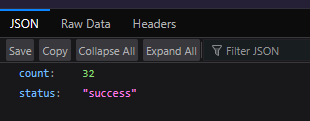

# Cloud Resume Challenge

This is a learning repository for performing the Cloud Resume Challenge as outlined below. The checklist below follows the website's list.

-   https://cloudresumechallenge.dev/

## Deployment Steps

This challenge will use Terraform to provision the infrastructure in GCP. The deployment steps are as follows:

1. Setup GCP CLI authentication
    1. `gcloud auth application-default login`
    2. `gcloud config set project PROJECT_ID`
2. Create a terraform.tfvars file with the following variables set:

```
   project_name = ""
   region = ""
   bucket_suffix = ""
   domain = ""
```

3. Initialize terraform
    1. `cd terraform-gcp/`
    2. `terraform init`
    3. `terraform plan`
4. Deploy
    1. `terraform apply`

Requirements:

-   GCP account and gcloud CLI
-   Terraform

## Checklist

-   [x] Get the Google Cloud Digital Leader certification (or higher)
-   [x] Write your resume in HTML
-   [x] Style your resume with CSS
-   [x] Deploy your HTML resume as a static website using Google Cloud Storage
-   [x] Enable HTTPS using a Cloud Load Balancer and Cloud CDN
-   [x] Point a custom DNS domain to your load balancer endpoint
-   [x] Add a JavaScript visitor counter to your resume webpage
-   [x] Store and update the visitor count in Google Cloud Firestore
-   [x] Create an API (e.g., with Google Cloud Functions) to interact with Firestore
-   [x] Write the serverless function in Python using Google Cloud Client Libraries
-   [x] Include tests for your Python code
-   [x] Define infrastructure using Terraform (Infrastructure as Code)
-   [x] Use GitHub for source control of backend code
-   [x] Set up CI/CD for backend with Cloud Build (run tests, deploy on success)
-   [x] Use a separate GitHub repo for website code and set up CI/CD for frontend
-   [x] Write and link a short blog post about your project learnings
    -   Adding screenshots and documentation here

## Data Flow



## Screenshots

Upon viewing the website, the visitor count gets increased and updated in Firestore as seen below:


The JSON response can be seen below:
